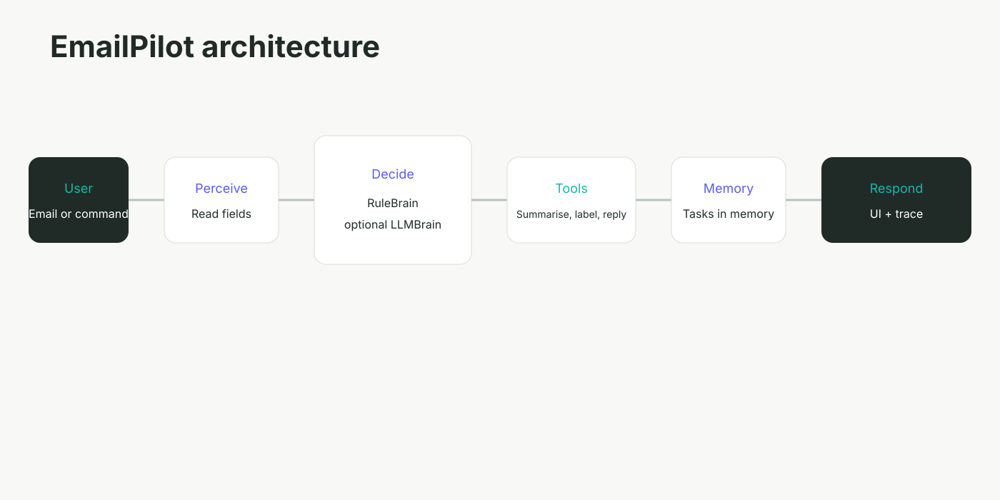

# EmailPilot

> Your inbox, handled by an AI agent.

EmailPilot is a small, explainable email-management agent built as a B.Tech CSE mini project at Dayananda Sagar University. It demonstrates the **Perceive → Decide → Act → Respond** agent loop using a working inbox populated entirely with fictional sample emails.

The default agent is rule-based, deterministic, and works offline. An optional browser-side LLM mode demonstrates model-assisted classification when a user supplies their own API key. This is a learning demo, **not a Gmail integration**: it does not sign in to Gmail, access a mailbox, send email, or persist messages.

**Presenter:** Tejas C. · **USN:** ENG25CS0055 · **Section:** 3A

**Project:** AI Agents – Case Studies and Practical Implementation · **Domain:** Personal Productivity

## What you can try

- Browse and open 12 fictional emails in a three-pane inbox.
- Classify messages as **Urgent**, **Needs reply**, **Task/Action**, **FYI**, **Newsletter**, or **Spam**.
- Inspect the 1–10 priority score and the signals behind it.
- Read a two-sentence extractive summary, detect possible tasks and deadlines, and add tasks to the current page session.
- Draft a formal, friendly, or brief reply and copy it.
- Schedule a follow-up locally, filter the inbox, and try the command bar.
- Run the evaluation against the sample set and see every expected and predicted label.
- Explore the case studies, architecture, example code, and Python version.

## How it works

The agent follows a short control loop:

1. **Perceive:** read the sender, sender role, subject, body, and displayed time from an email object.
2. **Decide:** classify the message with ordered rules and calculate a separate priority score.
3. **Act:** call small tools to summarize, find actions, draft a reply, label, search, or schedule a follow-up.
4. **Respond:** show the email, result, score, and a `[perceive]`, `[decide]`, `[act]`, `[respond]` trace.



### Classification rules

The browser implementation in [`src/agent/brain.js`](./src/agent/brain.js) applies rules in this order:

1. Prize, lottery, or suspicious-link wording → **Spam**
2. Newsletter, unsubscribe, weekly-digest, or promotional marker → **Newsletter**
3. A question or reply request → **Needs reply**, except for explicit urgency signals and an important sender’s “tomorrow” message
4. Urgency wording → **Urgent**
5. A recognized action phrase → **Task/Action**
6. Otherwise → **FYI**

Rule order is intentional: for example, a spam phrase should not become an ordinary reply request just because it contains a question mark. The rules are easy to inspect and change, but they are keyword heuristics, not a general understanding of language.

### Priority score

[`src/agent/scoring.js`](./src/agent/scoring.js) starts at 1 and adjusts the score using these signals:

| Signal | Score adjustment |
| --- | ---: |
| Each urgency word found (`urgent`, `asap`, `today`, `tomorrow`, `deadline`, `due`) | +2, capped at +5 total |
| Sender matches an important role (professor, HOD, manager, placement, mentor) | +2 |
| Message contains a question mark | +1 |
| A spam or bulk-mail marker is found | −2 |
| Final score | Clamped to 1–10 |

The score and category are related but separate: the classification rules select one label, while scoring adds up evidence. The UI shows the reasons used by the score.

### Agent tools

The reusable browser tools are in [`src/agent/tools.js`](./src/agent/tools.js):

| Tool | What it does |
| --- | --- |
| `classify_email` / `label_email` | Return the selected category and priority on an email |
| `summarize_email` | Return up to the first two sentences (extractive, not generated) |
| `extract_tasks` | Find supported action verbs and a simple “by Friday” style deadline |
| `draft_reply` | Make a formal, friendly, or brief template reply |
| `schedule_followup` | Validate a selected time and return a local scheduling record |
| `search_inbox` | Match a text query against sender, subject, and body |
| `daily_digest` | Count categories and collect urgent messages and detected tasks |

The demo has no backend or persistent task store. Tasks and follow-up confirmations live only in the open page session; scheduling does not create a real calendar event.

### RuleBrain and optional LLMBrain

- **RuleBrain** is the default. It uses local JavaScript rules, makes no model request, and works without an API key or network connection.
- **LLMBrain** is an optional browser-side classification example. The key is held in React component memory, is not saved to local storage, and is sent from the browser directly to the configured OpenAI API endpoint when the user requests LLM classification. Do not use a key you cannot safely expose to your own browser. Provider errors or unexpected output fall back to RuleBrain.
- No API key is required to build, test, or use the offline demo.

## Try the demo

In the command bar, try:

- `show urgent emails`
- `daily digest`
- `tasks due this week`
- `reply to email 3 politely`
- `search hackathon`

The command bar is a small intent router for these example phrases, **not an unrestricted natural-language parser**. The project does not connect to Gmail. Use the inbox panes to inspect sample messages and select an email directly.

## Evaluation

The live **Run evaluation** button applies the same browser classifier to all 12 sample emails, compares each predicted label with its expected label, and displays the individual pass/fail results and accuracy. The reference result for the current sample set is **12/12 labels correct**. This is a small hand-labelled demonstration set, not a claim about accuracy on real mail.

Run the focused agent checks locally:

```bash
npm test
```

The test script checks the sample labels, summary length, deadline extraction, reply tone, and inbox search. The report assets include:

- [`report/results.csv`](./report/results.csv) — expected and predicted sample labels.
- [`report/architecture.svg`](./report/architecture.svg) — scalable architecture diagram.
- [`report/architecture.png`](./report/architecture.png) — PNG copy of the diagram.
- [`report/desktop-hero.png`](./report/desktop-hero.png), [`report/live-demo.png`](./report/live-demo.png), [`report/test-results.png`](./report/test-results.png), [`report/mobile-demo.png`](./report/mobile-demo.png) — captured website states.

## Run locally

**Requirements:** Node.js 20 or newer and npm.

```bash
git clone https://github.com/Tejas-c-0/GmailPilot.git
cd GmailPilot
npm install
npm run dev
```

Open the local URL printed by Vite. The sample inbox and RuleBrain work offline once dependencies are installed. The optional LLM request requires internet access and a user-provided API key.

Build and preview the production version:

```bash
npm run build
npm run preview
```

The static site is written to `dist/`. No application server or environment variables are needed for the default build.

## Python version and Colab

[`emailpilot.py`](./emailpilot.py) contains a readable Python version of the core scoring, classification, summary, task extraction, and reply-template logic. Run the example locally:

```bash
python emailpilot.py
```

[`EmailPilot_Colab.ipynb`](./EmailPilot_Colab.ipynb) contains a short notebook walkthrough. The Python `LLMBrain` is intentionally an offline fallback stub; the optional API request is implemented in the browser app, not in the Python module. The two versions share the same rule-based approach, but their keyword patterns are implemented independently.

## Deploy

### Vercel

1. Sign in to [Vercel](https://vercel.com/) and choose **Add New → Project**.
2. Import `Tejas-c-0/GmailPilot` from GitHub and authorize repository access if prompted.
3. Let Vercel detect **Vite**, or set build command to `npm run build` and output directory to `dist`.
4. Deploy. Vercel will build future pushes to the connected branch automatically.

### Netlify

1. Sign in to [Netlify](https://www.netlify.com/) and choose **Add new site → Import an existing project**.
2. Connect `Tejas-c-0/GmailPilot`.
3. Set build command to `npm run build` and publish directory to `dist` (also recorded in [`netlify.toml`](./netlify.toml)).
4. Deploy. Future pushes to the connected branch trigger new builds.

For a one-off manual upload, run `npm run build` and upload the generated `dist/` folder in the Netlify dashboard.

### GitHub Pages

This repository includes [`.github/workflows/deploy-pages.yml`](./.github/workflows/deploy-pages.yml), which builds the Vite site and deploys it with GitHub Actions.

1. Open the repository’s **Settings → Pages**.
2. Set **Build and deployment → Source** to **GitHub Actions**.
3. Ensure Actions are allowed to deploy Pages for the repository.
4. Push to `main` or run the workflow manually from the **Actions** tab.
5. Check the workflow run for the published URL. For this repository, the expected project-site URL is `https://tejas-c-0.github.io/GmailPilot/`.

The workflow builds with `GITHUB_PAGES=true`; [`vite.config.js`](./vite.config.js) then sets the project-site base path. Pages must be enabled in repository settings before the first deployment can succeed.

## Project map

| Path | Purpose |
| --- | --- |
| [`src/App.jsx`](./src/App.jsx) | Single-page report, interactive demo, evaluation, and tabs |
| [`src/styles.css`](./src/styles.css) | Responsive layout, theme, dark mode, and component styles |
| [`src/components/HeroVisual.jsx`](./src/components/HeroVisual.jsx) | Lazy-loaded Three.js hero visual with a CSS fallback |
| [`src/agent/brain.js`](./src/agent/brain.js) | Category rules, trace, RuleBrain, and optional LLMBrain |
| [`src/agent/scoring.js`](./src/agent/scoring.js) | Priority score and signal explanations |
| [`src/agent/tools.js`](./src/agent/tools.js) | Summary, tasks, reply, labels, follow-up, search, and digest |
| [`src/agent/sampleInbox.js`](./src/agent/sampleInbox.js) | The 12 fictional messages and their expected labels |
| [`src/agent/tests.js`](./src/agent/tests.js) | Node-based checks for the agent behavior |
| [`emailpilot.py`](./emailpilot.py) | Python implementation of the core offline logic |
| [`EmailPilot_Colab.ipynb`](./EmailPilot_Colab.ipynb) | Notebook example for a Colab walkthrough |
| [`report/`](./report/) | Architecture diagram, screenshots, and CSV results |
| [`Viva_Guide.md`](./Viva_Guide.md) | 15 likely presentation questions with concise answers |

## Design and accessibility

The page uses a responsive three-pane desktop inbox and stacked inbox/reader/AI tabs on small screens. It includes a light/dark toggle, keyboard focus styling, reduced-motion handling, and a CSS fallback if WebGL is unavailable. The hero’s Three.js module and motion libraries are loaded lazily.

## Limitations and future work

- Classification and task extraction are keyword-based and can miss paraphrases or nuanced context.
- The evaluation contains only 12 fictional messages; its result should not be generalized to real inboxes.
- There is no Gmail OAuth/API integration, backend, calendar write, or persistent memory.
- The LLM mode sends the selected message text to the provider when invoked; do not use confidential email content.
- A future version could add a consent-based mail connector, stronger multilingual extraction, calendar integration, persistence controls, and a broader evaluation set.

## Academic context

**Dayananda Sagar University · B.Tech CSE · Section 3A**

**Mini project:** AI Agents – Case Studies and Practical Implementation

**Project title:** EmailPilot – an AI Email Management Agent

**Presenter:** Tejas C. · **USN:** ENG25CS0055
